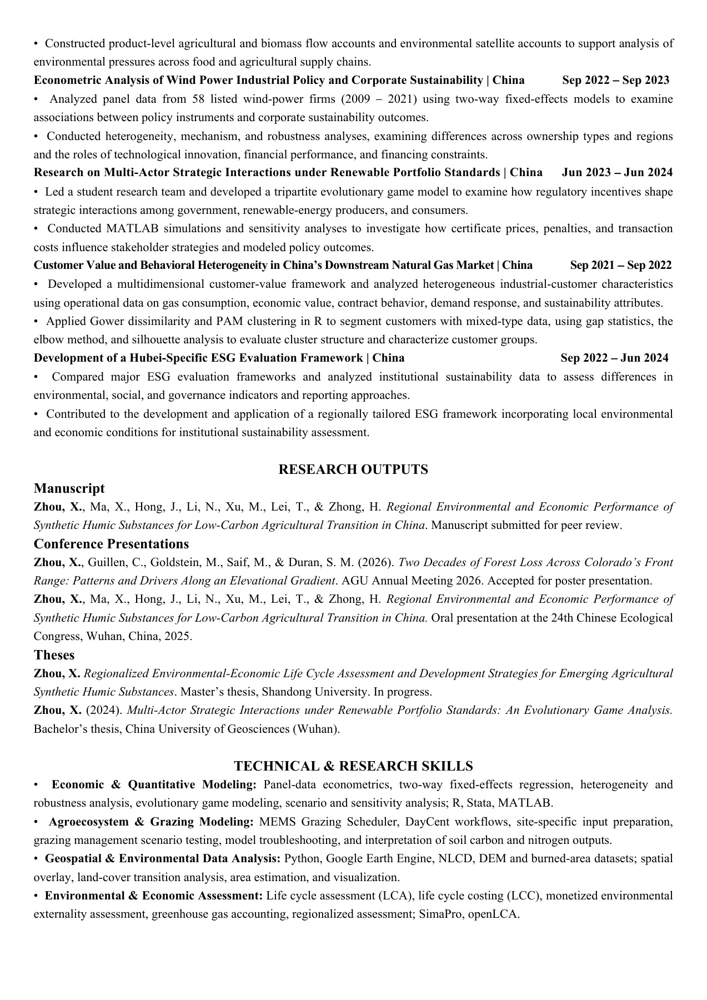
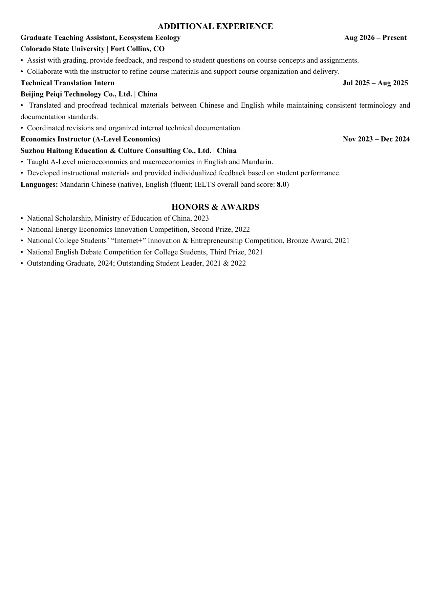

<h1>Curriculum Vitae</h1>
<a class="research-button" href="Xinran_Zhou_Academic_CV.pdf?v=20261115-corrected" download="Xinran_Zhou_Academic_CV.pdf">Download CV (PDF)</a><a href="Xinran_Zhou_Academic_CV.pdf?v=20261115-corrected" target="_blank" rel="noopener">Open PDF</a>

