

<header class="projects-intro"><h1>Research and Technical Experience</h1></header>
<section class="projects-group" id="selected-research" aria-labelledby="selected-research-title">
<h2 id="selected-research-title">Selected Research</h2>
<article class="project-entry" id="shs">
<h3>Environmental and economic assessment of synthetic humic substances</h3>

This research at Shandong University evaluates four synthetic humic substance production pathways and their agricultural applications in China. A regionalized LCA-LCC framework compares environmental impacts, production costs, and monetized environmental externalities across crop systems, regions, and electricity scenarios.

<figure class="research-plate shs-plate" aria-label="SHS research figure collection">

<h4>System boundary and LCA-LCC framework</h4><a href="assets/research/v2/shs-framework.png" target="_blank" rel="noopener" class="" aria-label="Open SHS system boundary and environmental-economic assessment framework at full size">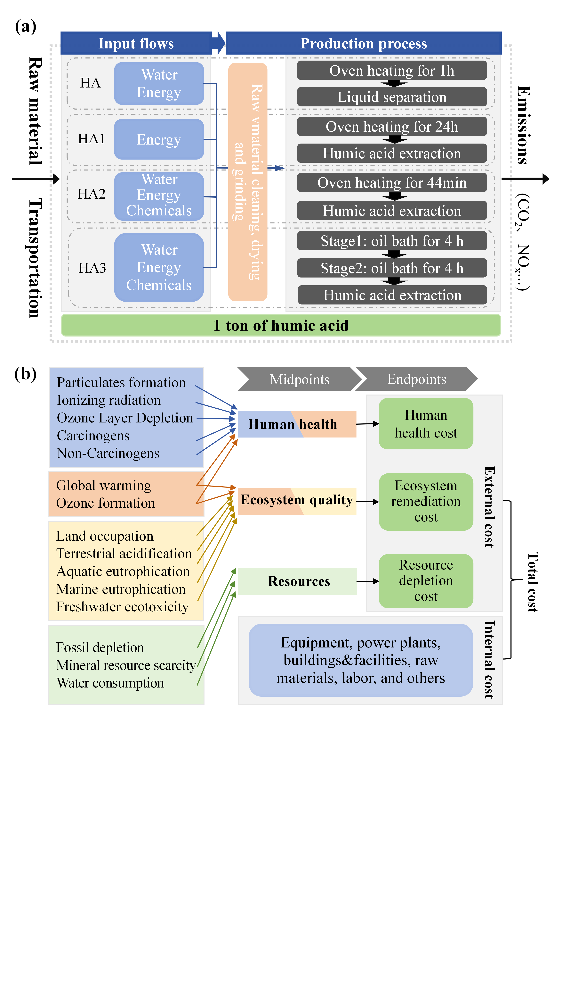</a>

<h4>Contributions to endpoint impacts</h4><a href="assets/research/v2/shs-sankey.png" target="_blank" rel="noopener" class="" aria-label="Open Sankey diagrams with complete flows for HA, HA1, HA2, and HA3 at full size">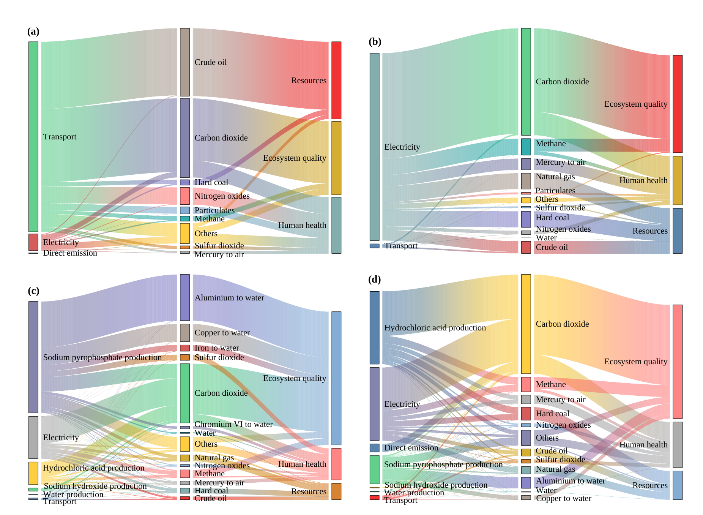</a>

<h4>Economic impacts across crop systems</h4><a href="assets/research/v2/shs-crop-costs.svg" target="_blank" rel="noopener" class="" aria-label="Open Internal and external economic impacts for wheat, maize, rice, and apple at full size">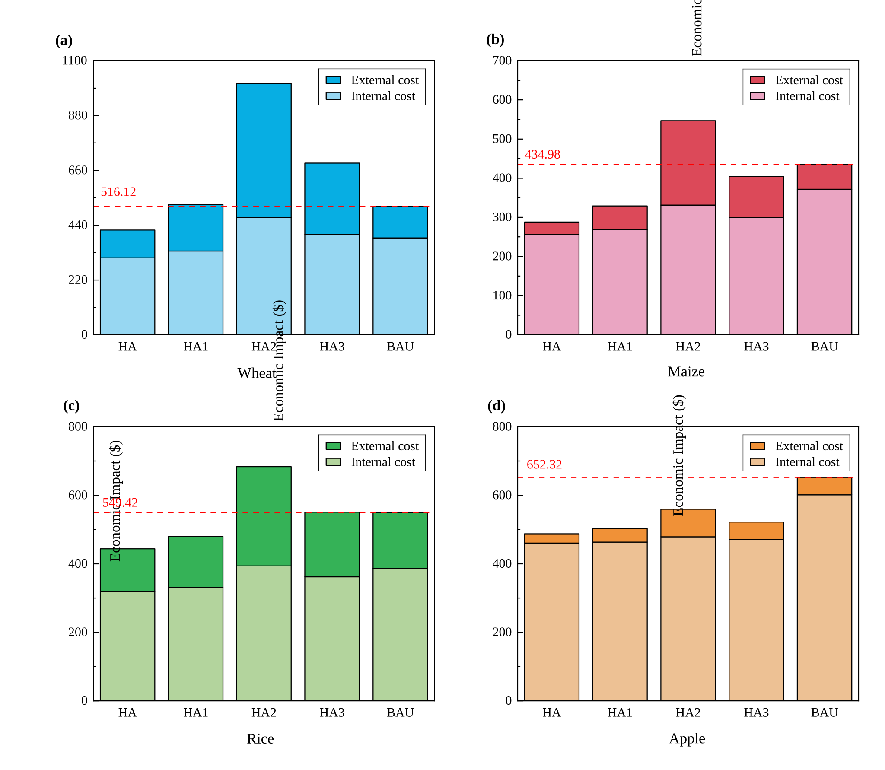</a>

<figcaption>Original figures from the SHS research materials. Sankey panels: (a) HA, (b) HA1, (c) HA2, (d) HA3. Costs compare modeled crop-production scenarios; they are not measured farm profits. Click any figure to enlarge.</figcaption></figure>

</article>
<article class="project-entry" id="esiil">
<h3>Forest cover change across Colorado’s Front Range, 2001–2021</h3>

Collaborative research at CU Boulder’s Environmental Data Science Innovation and Impact Lab (ESIIL) examines forest-cover change across Colorado’s Front Range. Python and Google Earth Engine workflows combine land-cover, elevation, and burned-area data to analyze land-cover transitions and spatial patterns of forest loss.

<figure class="research-plate forest-plate" aria-label="ESIIL research figure collection">

<h4>Land cover and forest change, 2001–2021</h4>

2001<a href="assets/research/v2/forest-2001.png" target="_blank" rel="noopener" class="" aria-label="Open NLCD land-cover map for 2001 at full size">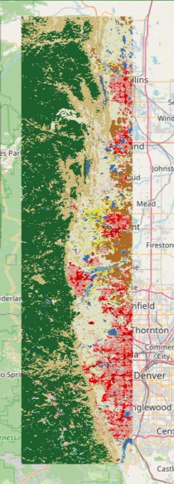</a>

2021<a href="assets/research/v2/forest-2021.png" target="_blank" rel="noopener" class="" aria-label="Open NLCD land-cover map for 2021 at full size">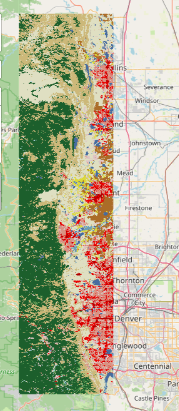</a>

Forest change<a href="assets/research/v2/forest-change.png" target="_blank" rel="noopener" class="" aria-label="Open Forest loss, gain, and stable forest map at full size">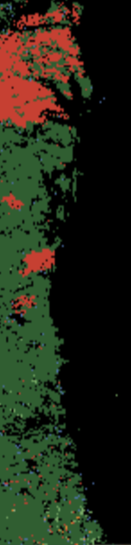</a>

<a href="assets/research/v2/forest-nlcd-legend.png" target="_blank" rel="noopener" class="" aria-label="Open NLCD land-cover class legend at full size">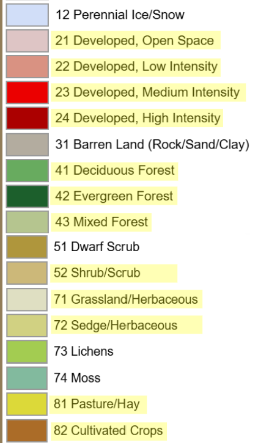</a><a href="assets/research/v2/forest-change-legend.png" target="_blank" rel="noopener" class="" aria-label="Open Forest change legend at full size">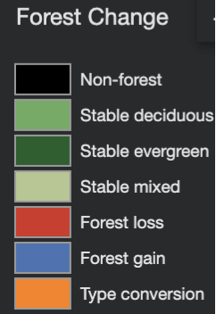</a>

<h4>Forest types across elevation</h4><a href="assets/research/v2/forest-elevation.png" target="_blank" rel="noopener" class="" aria-label="Open Elevation distributions of deciduous, evergreen, and mixed forest at full size">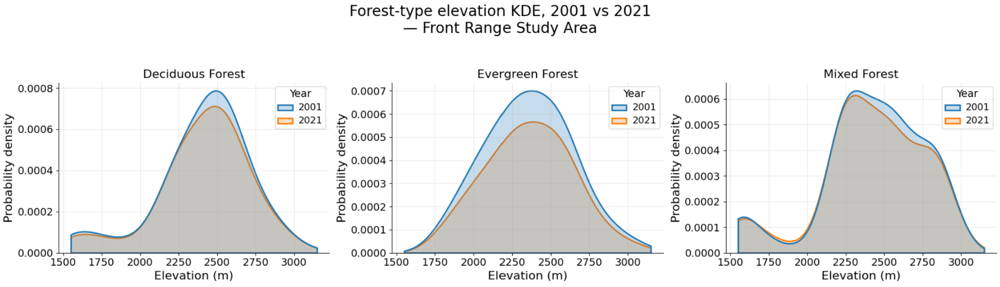</a>

<h4>Forest-loss probability</h4><a href="assets/research/v2/forest-loss-probability.png" target="_blank" rel="noopener" class="" aria-label="Open Forest-loss probability across the elevation gradient at full size">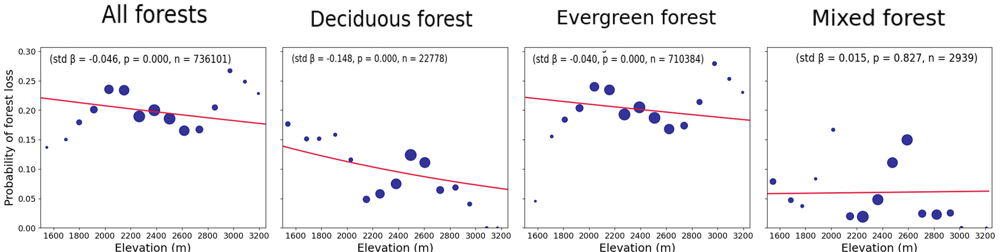</a>

<h4>Burned-area overlap and urban conversion</h4><a href="assets/research/v2/forest-burn-overlap.png" target="_blank" rel="noopener" class="" aria-label="Open Forest-loss area overlapping burned areas and conversion to urban land at full size">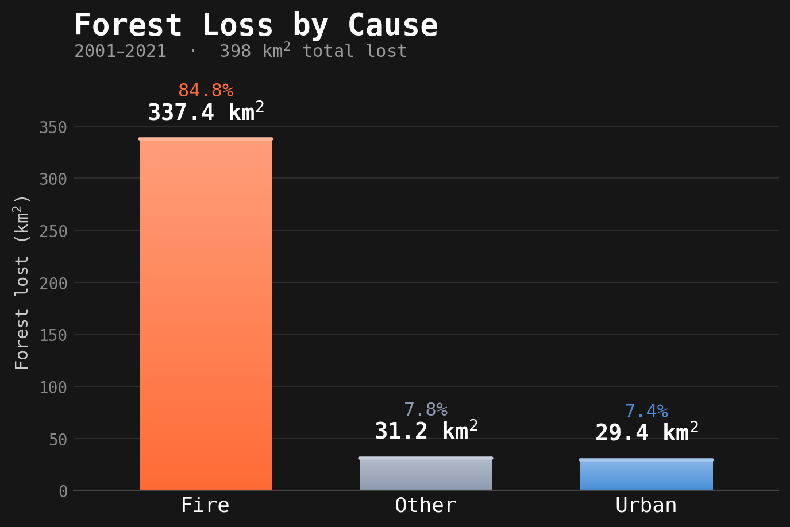</a>

<figcaption>Original maps and analyses from the ESIIL final presentation. Burned-area overlap indicates spatial association, not causation. Click any figure to enlarge.</figcaption></figure>

Collaborative ESIIL research with Camille Guillen, Malia Goldstein, Mohammad Saif, and Sandra M. Duran.

</article>
<article class="project-entry" id="wind-power">
<h3>Wind power policy and corporate sustainability</h3>

This study examines how wind-power policy instruments relate to corporate sustainability using panel data from 58 listed firms between 2009 and 2021. Two-way fixed-effects models are complemented by mechanism, robustness, and heterogeneity analyses across ownership types and regions.

</article>
<article class="project-entry" id="renewable-standards">
<h3>Renewable Portfolio Standards</h3>

A tripartite evolutionary game model examines interactions among government, renewable-energy producers, and consumers under Renewable Portfolio Standards. MATLAB simulations and sensitivity analyses explore how certificate prices, penalties, and transaction costs affect stakeholder strategies.

</article>
</section>
<section class="projects-group" id="technical-work" aria-labelledby="technical-work-title">
<h2 id="technical-work-title">Model Testing and Data Work</h2>
<article class="project-entry" id="landengine">
<h3>MEMS Grazing Scheduler testing</h3>

Technical work at LandEngine, Colorado State University, involved testing the MEMS Grazing Scheduler, reviewing model outputs, and documenting the workflow.

</article>
<article class="project-entry" id="fabio">
<h3>China-specific FABIO framework</h3>

Work on a China-specific Food and Agriculture Biomass Input-Output (FABIO) framework harmonizes agricultural, biomass, economic, and environmental data. Product-level flow accounts, mappings for 84 agricultural products, and environmental satellite accounts connect agricultural flows with environmental pressures.

</article>
</section>

