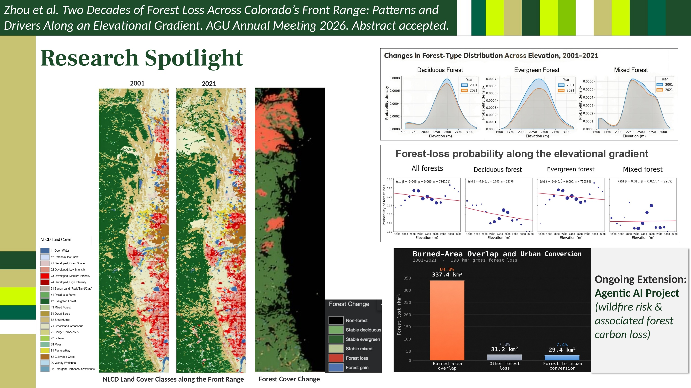

<header class="projects-intro"><h1>Research and Technical Experience</h1></header>
<section class="projects-group" id="selected-research" aria-labelledby="selected-research-title">
<h2 id="selected-research-title">Selected Research</h2>
<article class="project-entry" id="shs">
<h3>Environmental and economic assessment of synthetic humic substances</h3>

This research at Shandong University evaluates four synthetic humic substance production pathways and their agricultural applications in China. A regionalized LCA-LCC framework compares environmental impacts, production costs, and monetized environmental externalities across crop systems, regions, and electricity scenarios.

<figure class="work-figure ppt-work"></figure>

<a href="assets/research/Research_Spotlights.pdf?v=20261115-corrected#page=1" target="_blank" rel="noopener">View slides (PDF)</a> · <a href="assets/research/Research_Spotlights.pptx?v=20261115-corrected" download>Download PowerPoint</a>

Collaborative research with Xiaotian Ma, Jinglan Hong, Nan Li, Ming Xu, Tianjie Lei, and Honglin Zhong.

</article>
<article class="project-entry" id="esiil">
<h3>Forest cover change across Colorado’s Front Range, 2001–2021</h3>

Collaborative research at CU Boulder’s Environmental Data Science Innovation and Impact Lab (ESIIL) examines forest-cover change across Colorado’s Front Range. Python and Google Earth Engine workflows combine land-cover, elevation, and burned-area data to analyze land-cover transitions and spatial patterns of forest loss.

<figure class="work-figure ppt-work"></figure>

<a href="assets/research/Research_Spotlights.pdf?v=20261115-corrected#page=2" target="_blank" rel="noopener">View slides (PDF)</a> · <a href="assets/research/Research_Spotlights.pptx?v=20261115-corrected" download>Download PowerPoint</a>

Collaborative ESIIL research with Camille Guillen, Malia Goldstein, Mohammad Saif, and Sandra M. Duran.

</article>
<article class="project-entry" id="wind-power">
<h3>Wind power policy and corporate sustainability</h3>

This study examines how wind-power policy instruments relate to corporate sustainability using panel data from 58 listed firms between 2009 and 2021. Two-way fixed-effects models are complemented by mechanism, robustness, and heterogeneity analyses across ownership types and regions.

</article>
<article class="project-entry" id="renewable-standards">
<h3>Renewable Portfolio Standards</h3>

A tripartite evolutionary game model examines interactions among government, renewable-energy producers, and consumers under Renewable Portfolio Standards. MATLAB simulations and sensitivity analyses explore how certificate prices, penalties, and transaction costs affect stakeholder strategies.

</article>
</section>
<section class="projects-group" id="technical-work" aria-labelledby="technical-work-title">
<h2 id="technical-work-title">Model Testing and Data Work</h2>
<article class="project-entry" id="landengine">
<h3>MEMS Grazing Scheduler testing</h3>

Technical work at LandEngine, Colorado State University, involved testing the MEMS Grazing Scheduler, reviewing model outputs, and documenting the workflow.

</article>
<article class="project-entry" id="fabio">
<h3>China-specific FABIO framework</h3>

Work on a China-specific Food and Agriculture Biomass Input-Output (FABIO) framework harmonizes agricultural, biomass, economic, and environmental data. Product-level flow accounts, mappings for 84 agricultural products, and environmental satellite accounts connect agricultural flows with environmental pressures.

</article>
</section>

