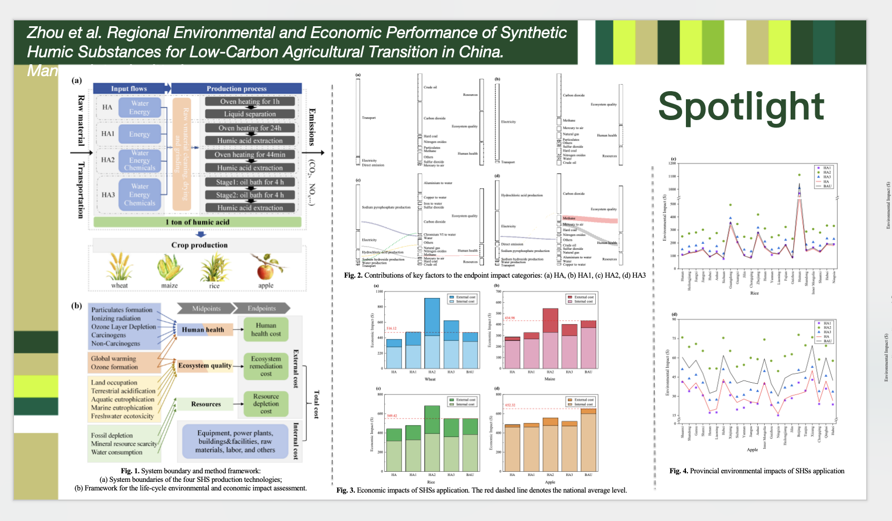
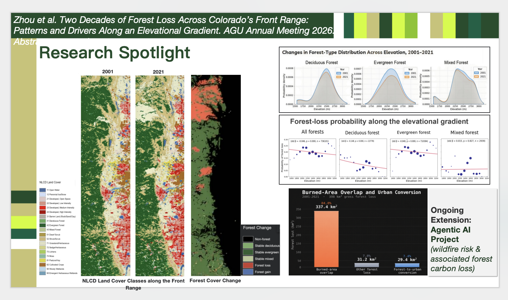
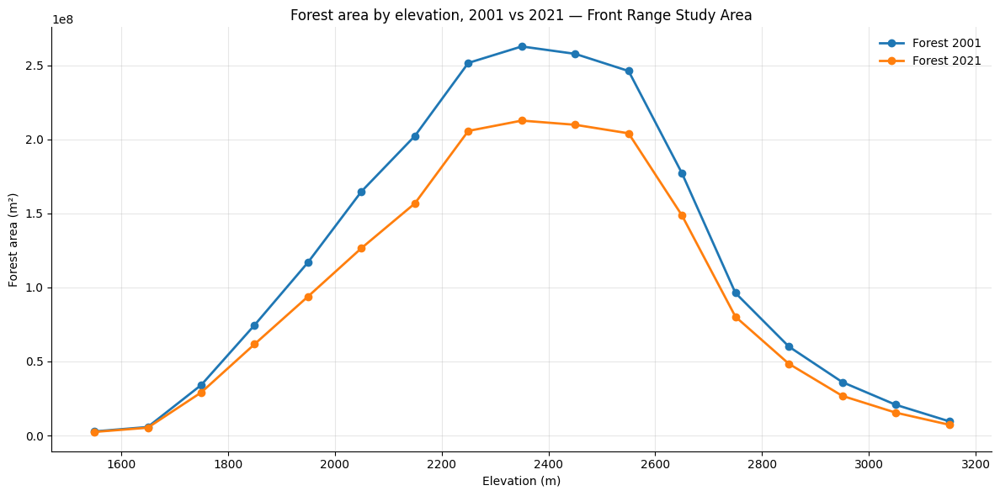
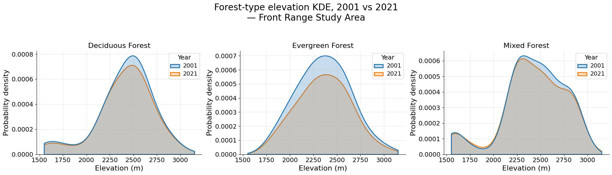

<header class="projects-intro"><h1>Research and Technical Experience</h1></header>
<section class="projects-group" id="selected-research" aria-labelledby="selected-research-title">
<h2 id="selected-research-title">Selected Research</h2>
<article class="project-entry" id="shs">
<h3>Environmental and economic assessment of synthetic humic substances</h3>
<figure class="work-figure spotlight-figure"><figcaption>Research spotlight: SHS production and agricultural application. <a href="assets/research/shs-spotlight.png" target="_blank" rel="noopener">View full-size image</a></figcaption></figure>

This research at Shandong University evaluates four synthetic humic substance production pathways and their agricultural applications in China. A regionalized LCA-LCC framework compares environmental impacts, production costs, and monetized environmental externalities across crop systems, regions, and electricity scenarios.

</article>
<article class="project-entry" id="esiil">
<h3>Forest cover change across Colorado’s Front Range, 2001–2021</h3>
<figure class="work-figure spotlight-figure"><figcaption>Research spotlight: forest change across Colorado’s Front Range. The Agentic AI extension shown in the overview is ongoing; burned-area overlap does not establish causation. <a href="assets/research/forest-spotlight.png" target="_blank" rel="noopener">View full-size image</a></figcaption></figure>

Collaborative research at CU Boulder’s Environmental Data Science Innovation and Impact Lab (ESIIL) examines forest-cover change across Colorado’s Front Range. Python and Google Earth Engine workflows combine land-cover, elevation, and burned-area data to analyze land-cover transitions and spatial patterns of forest loss.

View forest area by elevation
<figure class="work-figure">

<figcaption>Forest area by 100 m elevation band, 2001 and 2021. Source: saved output from the ESIIL analysis notebook; NLCD forest classes 41–43. <a href="assets/research/forest-area-by-elevation.png" target="_blank" rel="noopener">View full-size figure</a></figcaption>
</figure>

View forest-type elevation distributions

<figure class="work-figure">

<figcaption>Area-weighted kernel density estimates for three forest types, using a common normalization within each panel. Density curves are not absolute forest-area estimates. Source: saved ESIIL notebook output. <a href="assets/research/forest-types-elevation-kde.png" target="_blank" rel="noopener">View full-size figure</a></figcaption>
</figure>

Collaborative ESIIL research with Camille Guillen, Malia Goldstein, Mohammad Saif, and Sandra M. Duran.

</article>
<article class="project-entry" id="wind-power">
<h3>Wind power policy and corporate sustainability</h3>

This study examines how wind-power policy instruments relate to corporate sustainability using panel data from 58 listed firms between 2009 and 2021. Two-way fixed-effects models are complemented by mechanism, robustness, and heterogeneity analyses across ownership types and regions.

</article>
<article class="project-entry" id="renewable-standards">
<h3>Renewable Portfolio Standards</h3>

A tripartite evolutionary game model examines interactions among government, renewable-energy producers, and consumers under Renewable Portfolio Standards. MATLAB simulations and sensitivity analyses explore how certificate prices, penalties, and transaction costs affect stakeholder strategies.

</article>
</section>
<section class="projects-group" id="technical-work" aria-labelledby="technical-work-title">
<h2 id="technical-work-title">Model Testing and Data Work</h2>
<article class="project-entry" id="landengine">
<h3>MEMS Grazing Scheduler testing</h3>

Technical work at LandEngine, Colorado State University, involved testing the MEMS Grazing Scheduler, reviewing model outputs, and documenting the workflow.

</article>
<article class="project-entry" id="fabio">
<h3>China-specific FABIO framework</h3>

Work on a China-specific Food and Agriculture Biomass Input-Output (FABIO) framework harmonizes agricultural, biomass, economic, and environmental data. Product-level flow accounts, mappings for 84 agricultural products, and environmental satellite accounts connect agricultural flows with environmental pressures.

</article>
</section>

